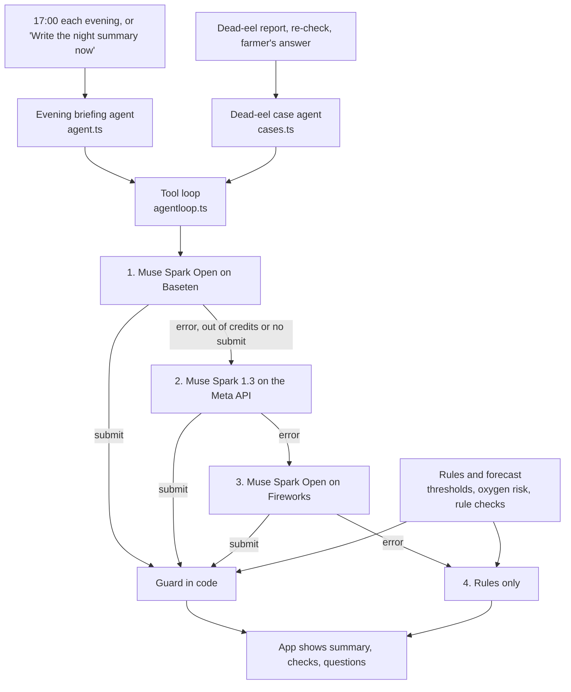

# Synt Eel

A phone app that helps Indonesian eel farmers keep glass eels and elvers alive through the nursery stage.

Built for the **Meta Global AI Developer Hackathon** (Oct 26 to Nov 4, 2026). Track: Indie. Theme: Build for Your World.

| | |
|---|---|
| Try the app | **[eel.synt.fun/preview/?lang=en](https://eel.synt.fun/preview/?lang=en)** (own demo farm, real Meta AI, in English) |
| Measured results | [`docs/evaluation.md`](docs/evaluation.md) |
| Meta models | Muse Spark 1.3, Muse Spark Open (Baseten and Fireworks), Muse Voice Transcribe, SAM 3.1 |

## The problem

Farmers in Indonesia buy glass eels and raise them to elvers over the first 12 weeks (minggu 0 to 12). Glass eels are small and see-through, and pond water can turn bad in a few hours. Deaths often happen overnight: by the time someone sees eels at the surface or the first dead ones in the morning, it is too late to act. Small farms have no oxygen meter. They measure temperature, pH and TDS once or twice a day and keep records in a notebook or in their heads.

Synt Eel is for these farmers and their workers. They talk or take photos at the pond, and the app turns that into pond records. From the records and the weather it estimates tonight's oxygen risk, tells them when to check, and walks them through a die-off. The goal is fewer deaths between glass eel and elver. Later, Synteel sensor prototypes will send readings that the same rules and agents read at set intervals and when something changes.

**Safety.** The app gives decision support. It does not diagnose disease or dose medicine. Alarms come from fixed threshold rules that run without any model, and every AI reading is a draft the farmer confirms before it is saved.

## Try it in 2 minutes

1. Open **https://eel.synt.fun/preview/?lang=en** on a phone, or in a narrow browser window. The link opens the app in English and the browser remembers it. The **Indonesia** and **English** buttons at the top switch the language before you sign in; later it is under Profil, **Language**.
2. Tap **Try the demo** below the Sign in and Create account buttons. You need no account or PIN. You get your own copy of the demo farm "Tambak Sidat Mitra": three ponds with two weeks of records up to today and an open dead-eel case on Kolam B. Nobody else sees your changes. The copy is deleted after 2 days; tapping **Try the demo** again later gives a fresh one.
3. The first screens already show agent output in English and Indonesian, written by the agents when the demo farm was prepared that day. Anything you do after that runs the models live.

Then try:

| Screen | What to do | Model behind it |
|---|---|---|
| Home | Kolam B has an open dead-eel case: 3 dead yesterday, 6 today. Tap **See the full case**, answer a question and tap **Send answers**. The case agent runs again with your answer and lists what it looked at. | Muse Spark Open (agent) |
| Watch | See each pond's 36-hour water temperature and oxygen-risk estimate and tonight's check times. Tap **Why?** to read tonight's summary from the evening briefing agent and what it looked at; checks marked **From the AI** were added by it. **Redo** runs the agent again. | Muse Spark Open (agent) |
| Record | Tap **Speak** and say something like "Pond A, 27 degrees, pH 7.4. Pond B, two dead." Indonesian and Javanese work too. Or try **Notebook photo** with a handwritten page. You review a draft before anything is saved. | Muse Voice Transcribe, Muse Spark 1.3 |
| Problem | Pick a pond and **Dead eels**, then **Photo for an AI count** with a photo of dead glass eels from above. Then **See what to do**. A dead-eel report opens a case on that pond too. | SAM 3.1 |

The preview calls the real Meta models. Photos, voice and notebook pages share a daily AI quota for each demo farm (Profil, **Daily AI reads**). Dead-eel counts and emergency reports do not use it. When the quota is used up or a model is down, the app says so and manual entry still works.

## What it does

| Feature | How it works | Code |
|---|---|---|
| Voice round | One recording about many ponds. Muse Voice Transcribe turns speech into text. Muse Spark 1.3 splits it per pond into a strict JSON schema; it knows Javanese number words ("selawe koma wolu" = 25.8). Code then matches pond names and nicknames, merges repeated ponds, turns pH 74 into 7.4 and asks about impossible values. | [`round.ts`](server/src/round.ts) |
| Meter photo, daily video | A photo of a pH, TDS or thermometer display becomes a reading. A video is cut on the phone into 12 frames and a 16 kHz soundtrack to save data. The phone checks blur and glare first. Captures wait in an offline queue until there is signal. | [`ai.ts`](server/src/ai.ts), [`media.ts`](web/src/capture/media.ts) |
| Notebook photo | Muse Spark copies each cell of a handwritten page as written. Code parses the numbers, drops values for blank cells and ditto marks, infers the year, matches ponds, and leaves pH 74 or 9 °C empty with 7.4 or 29 offered. The farmer saves the clear rows first and fixes the rest. | [`notebook.ts`](server/src/notebook.ts) |
| Risk forecast | Every 30 minutes the server estimates each pond's water temperature hour by hour from Open-Meteo weather. It re-anchors on each reading and learns a per-pond offset. It scores oxygen risk with reasons (warm water, eels at the surface, aerator, green water at night, density, leftover feed, rain, hours unwatched) and builds a check schedule with night alarms. No model involved. | [`nowcast.ts`](server/src/nowcast.ts), [`monitor.ts`](server/src/monitor.ts) |
| Threshold alarms | Water limits per phase from [`knowledge/`](knowledge/). A night check marked as an alarm opens a full-screen alarm with sound and vibration while the app is open in the browser. | [`rules.ts`](server/src/rules.ts), [`alarms.ts`](web/src/alarms.ts) |
| Evening briefing agent | From 17:00 farm time, or on request, the agent reads the farm through tools and writes a short summary plus extra checks. See [Agents](#agents). | [`agent.ts`](server/src/agent.ts) |
| Dead-eel case agent | A dead-eel report opens one case per pond that follows the die-off across days: dead per day, trend, a 1-hour re-check, up to 2 questions for the farmer, extra checks, and a WhatsApp message for the owner when the rules say deaths are rising or the re-check went unanswered. | [`cases.ts`](server/src/cases.ts) |
| Problem flow | The farmer picks a pond and what they see. The app shows steps from the emergency SOPs (kept on the phone for use without signal), possible causes from the pond's records and thresholds, when to ask the owner or an extension officer, and a WhatsApp summary. | [`problem.tsx`](web/src/screens/problem.tsx) |
| Dead eel count | One photo of the scoop, net or basin goes to SAM 3.1. The app outlines each eel, marks heads, and fills in one number, a range, or "at least N" when eels are piled up. The farmer can change it. | [`sam.ts`](server/src/sam.ts) |
| English interface | Indonesian by default. English on the sign-in screen, in Profil or with `?lang=en` switches the screens and the language the server and agents write in. An agent result written in the other language is written once more in the viewer's language and both are kept. | [`i18n.ts`](web/src/i18n.ts) |
| Demo farms | **Try the demo** copies a template farm for each visitor, with dates moved to today and the agents' results already in both languages. Copies are deleted after 48 hours; new copies are limited per network and in total. | [`demo.ts`](server/src/demo.ts) |
| Simulated devices | **Hubungkan alat** (Connect a device) links a Synteel device by code or QR. Simulated devices made on [eel.synt.fun/sim](https://eel.synt.fun/sim) get their own ponds labelled **Simulasi**, so simulated readings never mix with real ponds. Their readings go through the same rules, forecast and alarms. | [`devices.ts`](server/src/devices.ts) |
| Accounts | Phone number and 6-digit PIN, several farms per server, owners and workers, invite codes, installable as a PWA. | [`auth.ts`](server/src/auth.ts) |

## Meta models

| Model | Model id | What it does | Beyond a basic call |
|---|---|---|---|
| Muse Spark 1.3 (Meta Model API) | `muse-spark-1.3` | Reads meter photos, video frames and notebook pages; splits voice transcripts per pond; second provider for both agents | Strict JSON schema on every read. Code re-checks every value (plausible ranges, local pond matching, numbers parsed from the written text). On 402, 429 or 5xx the next provider takes over |
| Muse Spark Open on Baseten | `meta-models/muse-spark-open-1026` | First provider for both agents | Open-weight model in a tool-calling loop (6 tools for the briefing, 8 for the case) with a code guard on what it submits |
| Muse Spark Open on Fireworks | `accounts/fireworks/models/muse-spark-open` | Fallback for capture reading; third provider for both agents | Automatic failover when the Meta API is down or out of credits. `SYNTEEL_AI_PROVIDER=fireworks` puts it first for capture |
| Muse Voice Transcribe | `muse-voice-transcribe-1.0` | Voice notes, voice rounds, video soundtracks, spoken answers to case questions, spoken help messages | The phone converts audio to WAV. The transcript goes through Muse Spark extraction and the local number guards. Without ASR the recording stays queued on the phone |
| SAM 3.1 (Meta Responses API) | `sam-3.1` | Counts dead glass eels and elvers in one photo | Four prompts in parallel: "transparent eel", "thin worm", "transparent worm" for bodies, "black eye" for heads; elver ponds add "worm". Code merges bodies that several prompts found, counts two eyes close together as one head, and treats an outline 1.7 times the typical size as possibly two eels. The phone sends the photo at 1600 px and 12% brighter so the eyes stand out |

## Agents

Two agents share one tool loop ([`agentloop.ts`](server/src/agentloop.ts)). Each tries the providers in order and falls back to a rules-only answer when all of them fail.



| | Evening briefing agent | Dead-eel case agent |
|---|---|---|
| Read tools | `get_ponds`, `get_pond_history`, `get_night_forecast`, `get_weather`, `search_guidance` | `get_case`, `get_pond_logs`, `get_forecast`, `search_guidance` |
| Action tools | `submit_briefing` | `ask_farmer`, `add_check`, `draft_owner_message`, `submit_case_update` |
| Limits | Up to 5 extra checks, 8 rounds, 4 runs per farm per day | Up to 2 questions, 3 extra checks, 10 rounds, 6 agent runs per case per day |

What the agents may and may not do:

| May | May not |
|---|---|
| Read farm data through read-only tools | Remove or move a rule check or alarm: the guard puts every rule check back |
| Add checks on a real pond within the next 18 hours | Decide escalation or closing a case: rules decide both |
| Ask the farmer up to 2 short questions | Name a disease or give a diagnosis |
| Draft the owner's line under the rule-made facts | Mention medicine, doses or treatment |
| Write a summary of up to 3 sentences | Call rain heavy below 7.6 mm per hour, or state oxygen as measured |
| | Send anything: WhatsApp opens with the message filled in and the farmer sends it |

The guard drops a check with an unknown pond, a time past 18 hours, a duplicate of a rule check, or unsafe words. A summary that fails the guard is replaced by the rules summary. The app shows which tools the agent called, so the farmer can see what it looked at.

## Evaluation

Method, per-photo tables and limits are in [`docs/evaluation.md`](docs/evaluation.md). Live runs were on 29 and 30 October 2026.

| What | Result |
|---|---|
| SAM 3.1 dead eel count, 14 photos | Up to 16 eels lying apart (6 photos): every answer within 1 eel. 18 or more, or a pile (8 photos): no usable count. The low end never went above the true count (14 of 14). Median 1.8 s |
| Muse Spark, spoken Javanese and Indonesian numbers | 12 of 12 fields from 3 typed rounds, 4.2 to 5.2 s per round |
| Muse Spark, notebook pages (synthetic) | 216 cells over 5 reads: 200 right, 16 hard cells left empty and flagged as intended, 0 wrong |
| Evening briefing agent, 6 live runs | 6 of 6 finished with tool calls, 7 to 8 steps, 9.3 to 13.3 s. All 12 rule checks kept in every run |
| Not measured yet | ASR on real farmer recordings, meter photo accuracy, real notebook pages, the case agent live |

## Built during the hackathon vs. pre-existing

| Built during the hackathon (Oct 26 to Nov 4, 2026) | Pre-existing (before Oct 26) |
|---|---|
| All code in this repository: app, server, agents, rules engine, tests and evaluation | Synt Eel Nursery Blueprint v5, an internal design document. Its water thresholds, the 0 to 12 week glass eel program and the maintenance SOPs were transcribed into [`knowledge/`](knowledge/) as data |
| The knowledge base format and how the agents use it | 3D model of the Synt Nursery v5 system, shown only as a labelled pre-hackathon vision |
| Elver-stage practice from an interview with a partner eel farmer in Sleman ([`knowledge/partner-practice.json`](knowledge/partner-practice.json)) | Website [eel.synt.fun](https://eel.synt.fun), revised during the event. It is not part of this submission |

Commit history in this repository starts on Oct 26, 2026.

## Architecture

```
web/        Vite + Preact phone app (PWA), Indonesian and English
server/     Node 24 + Hono + built-in SQLite (node:sqlite); holds the API keys
knowledge/  Thresholds, the week 0 to 12 program, SOPs, emergencies, partner practice (JSON)
scripts/    Demo seed, offline evaluation, Meta API check
docs/       Evaluation
```

The phone talks only to the server. The server calls the Meta Model API (Muse Spark 1.3, Muse Voice Transcribe, SAM 3.1), Baseten and Fireworks (Muse Spark Open), and Open-Meteo for weather. Rules, forecast and alarms are plain TypeScript with no model in the path.

## Run locally

Requires Node.js 24 or newer.

```sh
npm install
# Keys go in ~/.synteel.env, outside the repo (see .env.example):
#   META_API_KEY=...        Muse Spark, Muse Voice Transcribe, SAM 3.1
#   BASETEN_API_KEY=...     optional: Muse Spark Open for the agents
#   FIREWORKS_API_KEY=...   optional: Muse Spark Open fallback
npm run check:meta                              # which Muse models your keys reach
npm run seed:demo                               # demo template farm with two weeks of records (server stopped)
SYNTEEL_DEMO_PHONE=620000000000 npm run dev:server   # http://localhost:8787, enables "Coba demo"
npm run dev:web                                 # http://localhost:5173, proxies /api to the server
```

Without keys, start the server with `SYNTEEL_AI_MOCK=1` for labelled example drafts. `SYNTEEL_AI_DAILY_CAP` and `SYNTEEL_AI_FARM_CAP` limit real AI reads per day.

## Tests

```sh
npm test       # full test suite (node --test)
npm run eval   # offline evaluation: SAM fixture and count rules, voice, meter and notebook guards, agent guard and fallback, rules
```

Neither needs API keys.
