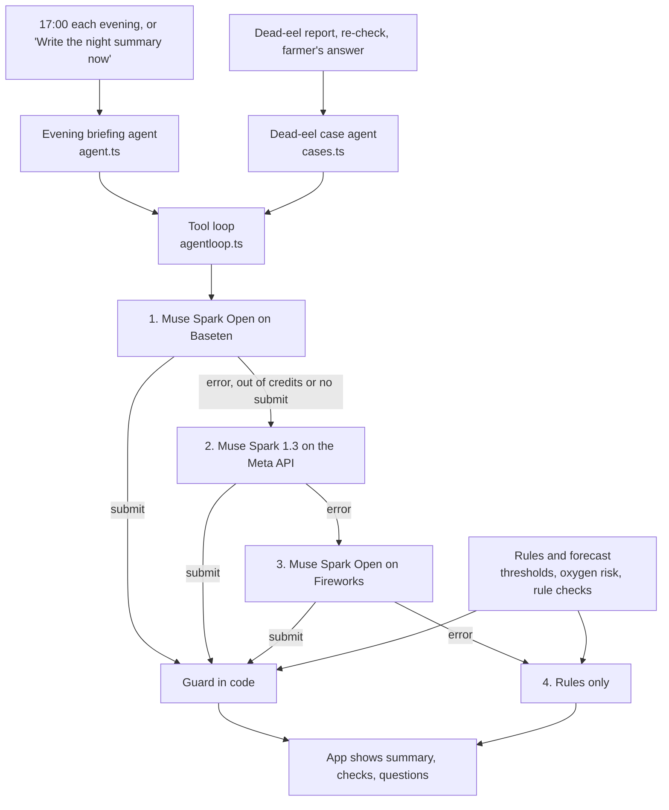

# Synteel

[](https://github.com/munf/synteel-app/actions/workflows/ci.yml)

A phone app that helps Indonesian eel farmers keep glass eels and elvers alive through the nursery stage.

Built for the **Meta Global AI Developer Hackathon** (Oct 26 to Nov 4, 2026). Track: Startup (Synteel is built by PT Synt Tekno Multikarya, Indonesia). Theme: Build for Your World.

| | |
|---|---|
| Try the app | **[eel.synt.fun/preview/?lang=en](https://eel.synt.fun/preview/?lang=en)** (own demo farm, real Meta AI, in English) |
| Android app | APK attached to the [latest release](https://github.com/munf/synteel-app/releases/latest). Android 7 or newer; it opens the same app full screen |
| Demo video | **[youtu.be/Ok2DkrIHnmA](https://youtu.be/Ok2DkrIHnmA)** (English) |
| Measured results | [`docs/evaluation.md`](docs/evaluation.md) |
| Meta models | Muse Spark 1.3, Muse Spark Open (Baseten and Fireworks), Muse Voice Transcribe, SAM 3.1 |

## The problem

Farmers in Indonesia buy glass eels and raise them to elvers over the first 12 weeks (minggu 0 to 12). Glass eels are small and see-through, and pond water can turn bad in a few hours. Deaths often happen overnight: by the time someone sees eels at the surface or the first dead ones in the morning, it is too late to act. Small farms have no oxygen meter. They measure temperature, pH and TDS once or twice a day and keep records in a notebook or in their heads.

Synteel is for these farmers and their workers. They talk or take photos at the pond, and the app turns that into pond records. From the records and the weather it estimates tonight's oxygen risk, tells them when to check, and walks them through a die-off. The goal is fewer deaths between glass eel and elver. Later, Synteel sensor prototypes will send readings that the same rules and agents read at set intervals and when something changes.

A partner farmer in Sleman, Yogyakarta, runs 6 ponds alone, with no workers. Their glass eels tend to die suddenly about two weeks after capture, and the farmer traces it to measurements and care that were forgotten. Readings were kept in memory, never written down. Nobody watches the ponds at night, and the mornings go to other work. The app answers those gaps with a check schedule and night alarms, records made by voice, and steps for the moment eels rise to the surface, which the farmer calls the most reliable warning sign.

**Safety.** The app gives decision support. It does not diagnose disease or dose medicine. Alarms come from fixed threshold rules that run without any model, and every AI reading is a draft the farmer confirms before it is saved.

## Try it in 2 minutes

1. Open **https://eel.synt.fun/preview/?lang=en** on a phone, or in a narrow browser window. The link opens the app in English and the browser remembers it. The **Indonesia** and **English** buttons at the top switch the language before you sign in; later it is under Profil, **Language**.
2. Tap **Try the demo** below the Sign in and Create account buttons. You need no account or PIN. You get your own copy of the demo farm "Tambak Sidat Mitra": three ponds with two weeks of records up to today and an open dead-eel case on Kolam B. Nobody else sees your changes. The copy is deleted after 2 days; tapping **Try the demo** again later gives a fresh one.
3. The first screens already show agent output in English and Indonesian, written by the agents when the demo farm was prepared that day. Anything you do after that runs the models live.

Then try:

| Screen | What to do | Model behind it |
|---|---|---|
| Home | Kolam B has an open dead-eel case: 3 dead yesterday, 6 today. Tap **See the full case**, answer a question and tap **Send answers**. The case agent runs again with your answer and lists what it looked at. | Muse Spark Open (agent) |
| Watch | See each pond's 36-hour water temperature and oxygen-risk estimate and tonight's check times. Tap **Why?** to read tonight's summary from the evening briefing agent and what it looked at; checks marked **From the AI** were added by it. **Redo** runs the agent again. | Muse Spark Open (agent) |
| Record | Tap **Speak** and say something like "Pond A, 27 degrees, pH 7.4. Pond B, two dead." Indonesian and Javanese work too. Or try **Notebook photo** with a handwritten page. You review a draft before anything is saved. | Muse Voice Transcribe, Muse Spark 1.3 |
| Problem | Pick a pond and **Dead eels**, then **Photo for an AI count** with a photo of dead glass eels from above. Then **See what to do**. A dead-eel report opens a case on that pond too. | SAM 3.1 |

The preview calls the real Meta models. Photos, voice and notebook pages share a daily AI quota for each demo farm (Profil, **Daily AI reads**). Dead-eel counts and emergency reports do not use it. When the quota is used up or a model is down, the app says so and manual entry still works.

## What it does

| Feature | How it works | Code |
|---|---|---|
| Voice round | One recording about many ponds. Muse Voice Transcribe turns speech into text. Muse Spark 1.3 splits it per pond into a strict JSON schema; it knows Javanese number words ("selawe koma wolu" = 25.8). Code then matches pond names and nicknames, merges repeated ponds, turns pH 74 into 7.4 and asks about impossible values. | [`round.ts`](server/src/round.ts) |
| Meter photo, daily video | A photo of a pH, TDS or thermometer display becomes a reading. A video is cut on the phone into 12 frames and a 16 kHz soundtrack to save data. The phone checks blur and glare first. Captures wait in an offline queue until there is signal. | [`ai.ts`](server/src/ai.ts), [`media.ts`](web/src/capture/media.ts) |
| Notebook photo | Muse Spark copies each cell of a handwritten page as written. Code parses the numbers, drops values for blank cells and ditto marks, infers the year, matches ponds, and leaves pH 74 or 9 °C empty with 7.4 or 29 offered. The farmer saves the clear rows first and fixes the rest. | [`notebook.ts`](server/src/notebook.ts) |
| Risk forecast | Every 30 minutes the server estimates each pond's water temperature hour by hour from Open-Meteo weather. It re-anchors on each reading and learns a per-pond offset. It scores oxygen risk with reasons (warm water, eels at the surface, aerator, green water at night, density, leftover feed, rain, hours unwatched) and builds a check schedule with night alarms. No model involved. | [`nowcast.ts`](server/src/nowcast.ts), [`monitor.ts`](server/src/monitor.ts) |
| Power-cut nights | Aerators that stop when the power goes out at night kill whole batches. For tonight (17:00 to 06:00) the server cross-checks Open-Meteo (thunderstorm codes, gusts, heavy rain, unstable air) with the BMKG forecast for the farm's village and labels the night **Rawan / Mungkin / Kecil** with its reasons, and says so when the two disagree. A risky night adds preparation checks that follow the farm's power backup (generator, battery, none: feed less and decide who checks the aerator) and raises the danger of ponds whose oxygen risk is already up. **Listrik padam** records a power cut in one tap, shows the steps and a WhatsApp message, and ends with **Listrik sudah menyala**. The BMKG village is the one nearest the farm, or the owner's pick. No model involved. | [`power.ts`](server/src/power.ts), [`bmkg.ts`](server/src/bmkg.ts), [`outage.tsx`](web/src/screens/outage.tsx) |
| Threshold alarms | Water limits per phase from [`knowledge/`](knowledge/). A night check marked as an alarm opens a full-screen alarm with sound and vibration while the app is open in the browser. | [`rules.ts`](server/src/rules.ts), [`alarms.ts`](web/src/alarms.ts) |
| Check schedule | Watch lists tonight's checks. A check can be marked done from 30 minutes before its time, not earlier, so nobody ticks the night off in advance. A check marked by mistake can be undone right away. | [`watch.tsx`](web/src/screens/watch.tsx) |
| Listen | **Listen** on Watch sends the screen's text to Muse Spark, which retells it as one short spoken explanation: tonight's level, the reasons, then the next check and its time. The phone's own voice reads it. A guard keeps the facts: no new numbers, every clock time kept, no oxygen figure, treatment or diagnosis. Anything refused, slower than 15 s or without a model is read from the screen text as it is. | [`spoken.ts`](server/src/spoken.ts) |
| Evening briefing agent | From 17:00 farm time, or on request, the agent reads the farm through tools and writes a short summary plus extra checks. See [Agents](#agents). | [`agent.ts`](server/src/agent.ts) |
| Dead-eel case agent | A dead-eel report opens one case per pond that follows the die-off across days: dead per day, trend, a 1-hour re-check, up to 2 questions for the farmer, extra checks, and a WhatsApp message for the owner when the rules say deaths are rising or the re-check went unanswered. | [`cases.ts`](server/src/cases.ts) |
| Problem flow | The farmer picks a pond and what they see. The app shows steps from the emergency SOPs (kept on the phone for use without signal), possible causes from the pond's records and thresholds, when to ask the owner or an extension officer, and a WhatsApp summary. | [`problem.tsx`](web/src/screens/problem.tsx) |
| WhatsApp | Profil → **Kirim langkah lewat WhatsApp**: the farmer's own WhatsApp number, a code check, the opt-in, which messages (Problem-flow steps, tonight's check plan, a danger summary) and a consent tick. With the WhatsApp Cloud API configured the server sends them with approved templates; without it (today) the steps button opens WhatsApp on the phone with the text filled in. Messages hold only checked content (rules, SOP steps, saved readings; never a value held back as **Cek manual**), no model writes them, and each send is logged without its text or number. An extra channel: the phone alarm stays first. Setup, costs and the privacy draft: [`docs/whatsapp-plan.md`](docs/whatsapp-plan.md) | [`whatsapp.ts`](server/src/whatsapp.ts), [`whatsapp.tsx`](web/src/screens/whatsapp.tsx) |
| Dead eel count | One photo of the scoop, net or basin goes to SAM 3.1. The app outlines each eel, marks heads, and fills in one number, a range, or "at least N" when eels are piled up. The farmer can change it. | [`sam.ts`](server/src/sam.ts) |
| English interface | Indonesian by default. English on the sign-in screen, in Profil or with `?lang=en` switches the screens and the language the server and agents write in. An agent result written in the other language is written once more in the viewer's language and both are kept. | [`i18n.ts`](web/src/i18n.ts) |
| Cycle summary | **Siklus batch ini** on the pond screen: days since stocking, records per day, nights checked, readings in range, danger signs checked again, dead eels recorded. Survival only when the farmer entered both the stocked count and a sorting or harvest count, set against the 20–40% the partner farmer reported (labelled farmer-reported, not measured). The team dashboard's **Data lapangan** downloads it per batch as CSV or JSON without names or places. What to record over one cycle: [`docs/field-data-plan.md`](docs/field-data-plan.md) | [`cycle.ts`](server/src/cycle.ts) |
| Replay page | `<app>/replay/` (no sign-in): recorded AI runs step by step, from the input through each model call and its time to the code checks with ✓ or ✗ and what the farmer saw. Real-API runs from the benchmark and demo runs with sample answers are labelled apart; the bundle is anonymised | [`replay.ts`](server/src/replay.ts), [`replay-export.ts`](scripts/replay-export.ts) |
| Demo farms | **Try the demo** copies a template farm for each visitor, with dates moved to today and the agents' results already in both languages. Copies are deleted after 48 hours; new copies are limited per network and in total. | [`demo.ts`](server/src/demo.ts) |
| Simulated devices | **Hubungkan alat** (Connect a device) links a Synteel device by code or QR. Simulated devices made on [eel.synt.fun/sim](https://eel.synt.fun/sim) get their own ponds labelled **Simulasi**, so simulated readings never mix with real ponds. Their readings go through the same rules, forecast and alarms. | [`devices.ts`](server/src/devices.ts) |
| Accounts | Phone number and 6-digit PIN, sign-up and forgotten PIN by e-mail code, terms accepted at sign-up, several farms per server, owners and workers, invite codes, installable as a PWA. Photos and recordings stay on the server only when the farmer turns that on in Profil, and the farmer can delete the account there. | [`auth.ts`](server/src/auth.ts), [`terms.ts`](server/src/terms.ts) |
| Android app | A Trusted Web Activity (package `fun.synt.eel`, built with Bubblewrap) that opens the app full screen without a browser bar. It shows a crash report with a copy button if it fails to start. The APK is attached to each release. | |

## Meta models

All model calls go from the server; the phone never holds a key. Muse Spark 1.3, Muse Voice Transcribe and SAM 3.1 run on Meta's hosted Model API. Muse Spark Open is Meta's open-weight model, served by Baseten and Fireworks. No model from another company is used in the app.

| Model | Model id | What it does | Beyond a basic call |
|---|---|---|---|
| Muse Spark 1.3 (Meta Model API) | `muse-spark-1.3` | Reads meter photos, video frames and notebook pages; splits voice transcripts per pond; second provider for both agents | Strict JSON schema on every read. Code re-checks every value (plausible ranges, local pond matching, numbers parsed from the written text). On 402, 429 or 5xx the next provider takes over |
| Muse Spark Open on Baseten | `meta-models/muse-spark-open-1026` | First provider for both agents and for Listen | Open-weight model in a tool-calling loop (7 tools for the briefing, 8 for the case) with a code guard on what it submits |
| Muse Spark Open on Fireworks | `accounts/fireworks/models/muse-spark-open` | Fallback for capture reading; third provider for both agents | Automatic failover when the Meta API is down or out of credits. `SYNTEEL_AI_PROVIDER=fireworks` puts it first for capture |
| Muse Voice Transcribe | `muse-voice-transcribe-1.0` | Voice notes, voice rounds, video soundtracks, spoken answers to case questions, spoken help messages | The phone converts audio to WAV. The transcript goes through Muse Spark extraction and the local number guards. Without ASR the recording stays queued on the phone |
| SAM 3.1 (Meta Responses API) | `sam-3.1` | Counts dead glass eels and elvers in one photo | Four prompts in parallel: "transparent eel", "thin worm", "transparent worm" for bodies, "black eye" for heads; elver ponds add "worm". Code merges bodies that several prompts found, counts two eyes close together as one head, and treats an outline 1.7 times the typical size as possibly two eels. The phone sends the photo at 1600 px and 12% brighter so the eyes stand out |

Which provider and model does each task, in which order, is one table in [`providers.ts`](server/src/providers.ts): speech to text, reading drafts, the agents and SAM. The order above is the default, kept until the benchmark shows a better one. A provider without its key is off, and `SYNTEEL_ROUTE_<TASK>` (e.g. `SYNTEEL_ROUTE_EXTRACT=fireworks,meta`) changes the order without a code change. An outage, overload or spent credits hands the task to the next entry, and the AI call ledger records the provider and model that answered. NVIDIA NIM (build.nvidia.com, OpenAI-compatible) is there as an opt-in entry read from `NVIDIA_API_KEY`, in no default route and not called yet. The night alarms are not a task in that table: a test checks that the rules and the forecast cannot reach a model module.

## Agents

Two agents share one tool loop ([`agentloop.ts`](server/src/agentloop.ts)). Each tries the providers in order and falls back to a rules-only answer when all of them fail.



| | Evening briefing agent | Dead-eel case agent |
|---|---|---|
| Read tools | `get_ponds`, `get_pond_history`, `get_night_forecast`, `get_weather`, `get_bmkg_forecast`, `search_guidance` | `get_case`, `get_pond_logs`, `get_forecast`, `search_guidance` |
| Action tools | `submit_briefing` | `ask_farmer`, `add_check`, `draft_owner_message`, `submit_case_update` |
| Limits | Up to 5 extra checks, 8 rounds, 4 runs per farm per day | Up to 2 questions, 3 extra checks, 10 rounds, 6 agent runs per case per day |

What the agents may and may not do:

| May | May not |
|---|---|
| Read farm data through read-only tools | Remove or move a rule check or alarm: the guard puts every rule check back |
| Add checks on a real pond within the next 18 hours | Decide escalation or closing a case: rules decide both |
| Ask the farmer up to 2 short questions | Name a disease or give a diagnosis |
| Draft the owner's line under the rule-made facts | Mention medicine, doses or treatment |
| Write a summary of up to 3 sentences | Call rain heavy below 7.6 mm per hour, or state oxygen as measured |
| | Send anything: WhatsApp opens with the message filled in and the farmer sends it |

The guard drops a check with an unknown pond, a time past 18 hours, a duplicate of a rule check, or unsafe words. A summary that fails the guard is replaced by the rules summary. The app shows which tools the agent called, so the farmer can see what it looked at.

## Verify before show, and the AI call ledger

Every model result passes code checks ([`verify.ts`](server/src/verify.ts)) before the farmer sees it. No model is asked:

| Result | Checks | When a check fails |
|---|---|---|
| Drafted log (photo, voice note, video) | Readings within plausible ranges (temperature, pH, TDS, DO), unit conversions flagged, every number in the log said in the recording (Indonesian, Javanese and English number words), the pond named is this pond on this farm | The value is held back: the field shows **Cek manual** with the reason and is not filled in |
| Voice round | The same per pond; the pond matched locally | The number becomes a question the farmer confirms or types |
| SAM 3.1 dead-eel count | Outlines non-empty, bodies and heads agree within 25%, no outline far larger or smaller than the others | **Cek manual**: the count is not filled in, the farmer counts from the photo |
| Evening briefing, case update | No medicine, dose or diagnosis; no "safe" or "calm" where the alarm rules see a warning or danger; no heavy rain or measured oxygen the data does not show | The rules' own summary is shown: the rules win |
| Notebook page | Each cell's own checks (`notebook.ts`) summed up | Cells marked for a look, as before |

Every model call goes through one function, `call()` in [`ai.ts`](server/src/ai.ts), and is written to the `ai_ledger` table ([`ledger.ts`](server/src/ledger.ts)): request id and kind, provider and model id, start time and latency, input and output tokens when the API returns them, an estimated cost from a small price table (sources in the file, marked as an estimate), the outcome (`ok`, `fallback`, `error`, `mock`), the result's verification, and the farm, pond and result it served. No audio, images or farmer text are stored. Under each AI result the farmer can open **Cara AI memproses ini**: the steps, model names, time taken and each check with a tick or a cross, without costs. The team dashboard (Pemakaian AI) lists recent calls, totals per model and the estimated cost per pond per night.

## Other components (not Meta models)

| Component | Where | Role |
|---|---|---|
| Phone text-to-speech | **Listen** on Watch | The browser's built-in speech (Web Speech API, the voice of the phone's operating system) reads the text Muse Spark wrote. It is not a Meta model and nothing is sent anywhere for it |
| Rules, forecast, alarms | `rules.ts`, `nowcast.ts`, `monitor.ts`, `power.ts` | Plain TypeScript, no model. The water temperature estimate is arithmetic on weather data |
| Open-Meteo, BMKG | Server | Weather and village forecast data, see [Data sources](#data-sources-and-licences) |
| Hono, Preact, Vite, `node:sqlite`, `@meta-sam/parser` | Server and app | Open-source libraries (see `package.json` files) |
| Plus Jakarta Sans | App | Typeface, SIL Open Font License, bundled via `@fontsource-variable` |
| Bubblewrap, Chrome | Android app | Google's tool that wraps the web app as a Trusted Web Activity; it runs in the phone's Chrome |
| Demo video | Not in this repo | Animated with Remotion. The English narration is an AI voice from ElevenLabs, made for the video only; the app never calls it. Screens in the video are recreated from the app, and simulated parts are labelled |

## Evaluation

Method, per-photo tables and limits are in [`docs/evaluation.md`](docs/evaluation.md). Live runs were on 29 and 30 October 2026.

Steps you cannot rerun yourself, and where their recorded output is:

| Step | Recorded output |
|---|---|
| Live SAM 3.1 counts on 14 photos | Per-photo tables in [`docs/evaluation.md`](docs/evaluation.md); one SAM answer kept as the test fixture `server/test/fixtures/sam-synth8.txt`, replayed by `npm run eval` |
| 6 live runs of the evening briefing agent | Steps, times and kept checks per run in [`docs/evaluation.md`](docs/evaluation.md) |
| Partner farm visits (Oct 27, Nov 1) | What the farmer said, in [`knowledge/partner-practice.json`](knowledge/partner-practice.json). Photos and recordings from the farm stay private |
| Android build and signing | The signed APK in the [latest release](https://github.com/munf/synteel-app/releases/latest); the signing key stays private |

| What | Result |
|---|---|
| SAM 3.1 dead eel count, 14 photos | Up to 16 eels lying apart (6 photos): every answer within 1 eel. 18 or more, or a pile (8 photos): no usable count. The low end never went above the true count (14 of 14). Median 1.8 s |
| Muse Spark, spoken Javanese and Indonesian numbers | 12 of 12 fields from 3 typed rounds, 4.2 to 5.2 s per round |
| Benchmark, 10 Nov 2026, Meta API (19 calls) | Typed rounds: 12 of 12 fields again; after the code checks 11 stay filled in. SAM on the 4 user-checked photos: 3 of 4 within 1 eel. Table in [`docs/evaluation.md`](docs/evaluation.md#benchmark-per-provider-and-model) |
| Muse Spark, notebook pages (synthetic) | 216 cells over 5 reads: 200 right, 16 hard cells left empty and flagged as intended, 0 wrong |
| Evening briefing agent, 6 live runs | 6 of 6 finished with tool calls, 7 to 8 steps, 9.3 to 13.3 s. All 12 rule checks kept in every run |
| Not measured yet | ASR on real farmer recordings, meter photo accuracy, real notebook pages, the case agent live |

## Known limits

- **Alarms need the app open.** A night check alarm rings full screen with sound while the app is on screen. With the app closed nothing rings yet, and the Android app shows no system notification. Alarms that reach a closed or locked phone are planned for the update after the hackathon.
- **Glass eel limits are still being researched.** Alarms use the Blueprint v5 limits for glass eels: 27 to 28 °C ideal, caution above 29 °C, danger above 30 °C, pH 7.0 to 7.8. The partner farmer keeps glass eels and elvers at 28 to 31 °C and pH 6.8 to 7.6, and elver ponds already use that range. We will compare both with published research before changing the rules.
- **The Android app runs in Chrome.** Android shows a short "Running in Chrome" note, and a phone without Chrome opens the app in another browser, which may show an address bar.
- **Not measured yet:** see [Evaluation](#evaluation).

## Built during the hackathon vs. pre-existing

| Built during the hackathon (Oct 26 to Nov 4, 2026) | Pre-existing (before Oct 26) |
|---|---|
| All code in this repository: app, server, agents, rules engine, tests and evaluation | Synt Eel Nursery Blueprint v5, an internal design document. Its water thresholds, the 0 to 12 week glass eel program and the maintenance SOPs were transcribed into [`knowledge/`](knowledge/) as data |
| The knowledge base format and how the agents use it | Website [eel.synt.fun](https://eel.synt.fun), revised during the event. It is not part of this submission |
| Glass eel and elver practice from a partner eel farmer in Sleman, Oct 27 and Nov 1 ([`knowledge/partner-practice.json`](knowledge/partner-practice.json)) | |
| The Android app (Trusted Web Activity) and the demo video | |

Commit history in this repository starts on Oct 26, 2026 (first commit 22:12 UTC).

## Architecture

```
web/        Vite + Preact phone app (PWA), Indonesian and English
server/     Node 24 + Hono + built-in SQLite (node:sqlite); holds the API keys
knowledge/  Thresholds, the week 0 to 12 program, SOPs, emergencies, partner practice (JSON)
scripts/    Demo seed, offline evaluation and benchmark, nowcast check, Meta API check
eval/       Labelled items for the benchmark, and how to add more
docs/       Evaluation, benchmark results (docs/eval-results/)
docker/     Container start script (Dockerfile, compose.yaml)
```

The phone talks only to the server. The server calls the Meta Model API (Muse Spark 1.3, Muse Voice Transcribe, SAM 3.1), Baseten and Fireworks (Muse Spark Open), Open-Meteo for weather and BMKG for the village forecast. Rules, forecast and alarms are plain TypeScript with no model in the path.

## Run locally

Requires Node.js 24 or newer. No account or API key is needed: with `SYNTEEL_AI_MOCK=1` every AI step returns a labelled example draft and everything else (rules, forecast, alarms, demo farm) runs as normal.

```sh
npm install
npm run seed:demo
SYNTEEL_AI_MOCK=1 SYNTEEL_DEMO_PHONE=620000000000 npm run dev:server   # http://localhost:8787
npm run dev:web                                                         # http://localhost:5173, tap "Coba demo" (Try the demo)
```

With keys, for the real Meta models:

```sh
# Keys go in ~/.synteel.env, outside the repo (see .env.example):
#   META_API_KEY=...        Muse Spark, Muse Voice Transcribe, SAM 3.1
#   BASETEN_API_KEY=...     optional: Muse Spark Open for the agents
#   FIREWORKS_API_KEY=...   optional: Muse Spark Open fallback
npm run check:meta                              # which Muse models your keys reach
npm run seed:demo                               # demo template farm with two weeks of records (server stopped)
SYNTEEL_DEMO_PHONE=620000000000 npm run dev:server   # http://localhost:8787, enables "Coba demo"
npm run dev:web                                 # http://localhost:5173, proxies /api to the server
```

Never commit a key: the file lives outside the repo, and `.env.example` holds only empty names. `SYNTEEL_AI_DAILY_CAP` and `SYNTEEL_AI_FARM_CAP` limit real AI reads per day.

### Run with Docker

One container serves the API and the built app on port 8787, with the database and photos in a volume. Keys and settings come from `.env` next to `compose.yaml` (copy `.env.example`; git and the image both leave it out). Without a model key every AI step returns a labelled example draft.

```sh
cp .env.example .env              # optional; add SYNTEEL_DEMO_PHONE=620000000000 for "Coba demo"
docker compose up --build         # http://localhost:8787
```

The image runs as an unprivileged user and has a health check on `/api/health`. With `SYNTEEL_DEMO_PHONE` set, the first start builds the demo farm. `SYNTEEL_HOST_PORT` picks another port on the host. eel.synt.fun does not run this image.

## Tests

```sh
npm test       # full test suite (node --test)
npm run eval   # offline evaluation: SAM fixture and count rules, voice, meter and notebook guards, agent guard and fallback, rules
npm run eval -- bench --mock   # the benchmark pipeline against a pretend API
```

The tests are in [`server/test/`](server/test/) (one file per server module), the labelled evaluation items in [`eval/`](eval/), and recorded results in [`docs/eval-results/`](docs/eval-results/). [GitHub Actions](.github/workflows/ci.yml) runs the tests, the type check, the build and both mock evaluations on every pull request.

None of these needs API keys. A live benchmark of one provider or model per task (`npm run eval -- bench --provider meta`, options at the top of [`scripts/eval.ts`](scripts/eval.ts)) does, and costs credits; [`eval/README.md`](eval/README.md) explains the data.

## Data sources and licences

| Data | Source | Licence and use |
|---|---|---|
| Hourly weather and storm signs | [Open-Meteo](https://open-meteo.com) | CC BY 4.0. Weather data by Open-Meteo.com |
| Village weather forecast, 3-hour steps | BMKG public forecast API, `api.bmkg.go.id/publik/prakiraan-cuaca` | BMKG open data. Called only by the server, cached per village for 2 hours and kept below BMKG's 60 requests per minute. The app shows "Sumber: BMKG" wherever BMKG data appears |
| Village codes (Kemendagri `adm4`), names and centres | [cahyadsn/wilayah](https://github.com/cahyadsn/wilayah) and [cahyadsn/wilayah_boundaries](https://github.com/cahyadsn/wilayah_boundaries) by Cahya DSN | MIT. Built into [`server/geo/desa.tsv.gz`](server/geo/) (83,762 villages, 1.2 MB) by [`scripts/build-desa.ts`](scripts/build-desa.ts); licence text in [`server/geo/LICENSE-wilayah.txt`](server/geo/LICENSE-wilayah.txt) |
